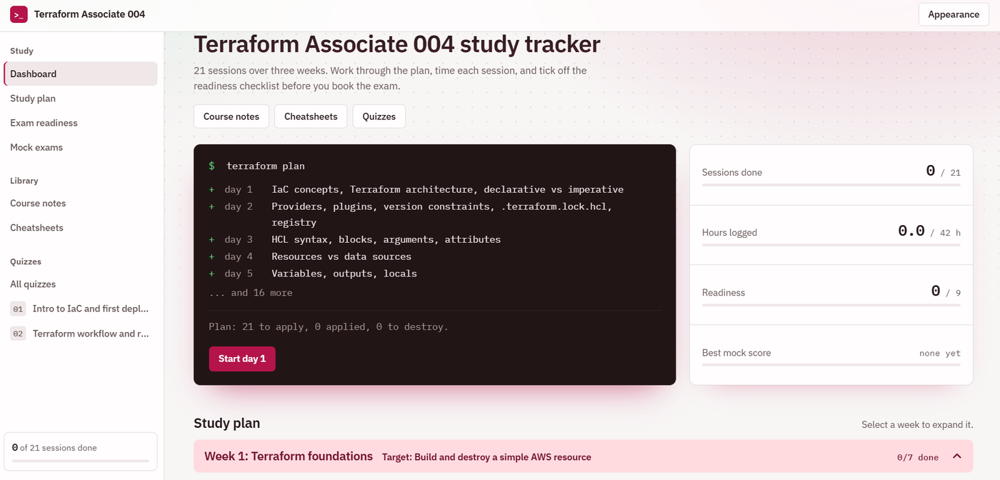
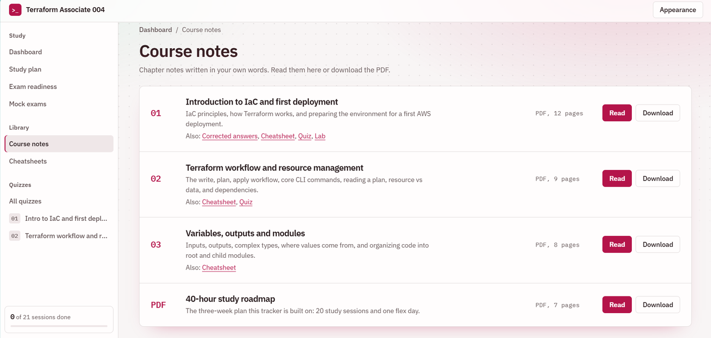
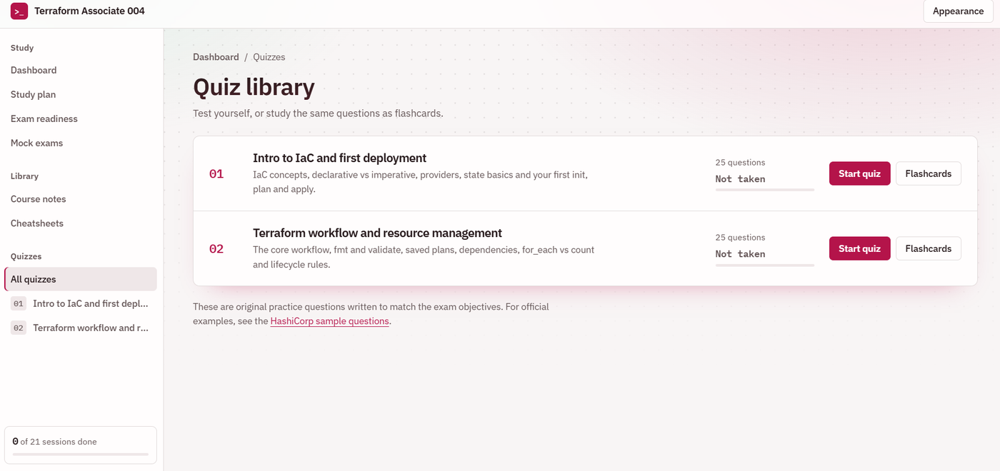

# Terraform Certification Prep

[](https://github.com/AjmiOns/terraform-associate-training/actions/workflows/pages.yml)
[](https://github.com/AjmiOns/terraform-associate-training/actions/workflows/validate.yml)

Study notes, quizzes and hands-on labs while preparing for the **HashiCorp Terraform Associate (004)** certification, alongside my university Infrastructure as Code course.

**Live site: https://ajmions.github.io/terraform-associate-training/**

[](https://ajmions.github.io/terraform-associate-training/)

## What is in the study site

- **Study tracker:** the 21-session, three-week plan with a timer per session, a `terraform plan`-style view of what is left, an exam readiness checklist and mock exam scores. Only Week 1 is open at first; the other weeks expand on click.
- **Course notes and cheatsheets:** every chapter PDF opens in a built-in reader, with links to the matching quiz and lab.
- **Quizzes:** 25 original practice questions per quiz, in the style of the exam. Each answer shows right or wrong straight away, with the reason. Every quiz can also be studied as flashcards.
- **Appearance:** light, dark or automatic mode and six accent colors, saved in your browser.

| Course notes | Quizzes |
|---|---|
| [](https://ajmions.github.io/terraform-associate-training/courses.html) | [](https://ajmions.github.io/terraform-associate-training/quiz/index.html) |

Progress is saved in your browser only. Use **Export backup** on the tracker before clearing site data.

## Structure

| Path | Content |
|---|---|
| `course/` | Chapter notes (PDF), written in my own words, plus corrected answers |
| `cheatsheets/` | Three-page quick references, one per chapter |
| `labs/` | Self-contained hands-on labs (each has its own `provider.tf` and state) |
| `website/` | The study site: tracker, library and quizzes (Bootstrap 5.3 plus plain JavaScript, no build step) |
| `tools/` | `validate-quizzes.js` (data checks) and `build-site.js` (assembles the site) |
| `docs/` | Screenshots used in this README |
| `.github/workflows/` | Quiz validation and GitHub Pages deployment |
| `SITE.md` | How the site works, how to add a quiz or a chapter |
| `Terraform_Associate_004_Study_Roadmap.pdf` | The 40-hour, three-week study plan |

## Progress

Notes and cheatsheets open in the site's reader. Each quiz has 25 questions.

| # | Chapter | Notes | Cheatsheet | Quiz | Lab | Done |
|---|---|---|---|---|---|---|
| 01 | Intro to IaC and first deployment | [Read](https://ajmions.github.io/terraform-associate-training/read.html?f=course%2F01-introduction-iac-terraform.pdf) | [Read](https://ajmions.github.io/terraform-associate-training/read.html?f=cheatsheets%2Fchapter01-cheatsheet.pdf) | [Take quiz](https://ajmions.github.io/terraform-associate-training/quiz/introduction.html) | [Lab 01](labs/01-first-deployment) ✅ | ✅ |
| 02 | Terraform workflow and resource management | [Read](https://ajmions.github.io/terraform-associate-training/read.html?f=course%2F02-workflow-terraform.pdf) | [Read](https://ajmions.github.io/terraform-associate-training/read.html?f=cheatsheets%2Fchapter02-cheatsheet.pdf) | [Take quiz](https://ajmions.github.io/terraform-associate-training/quiz/workflow.html) | ⬜ | ⬜ |
| 03 | Variables, outputs and modules | [Read](https://ajmions.github.io/terraform-associate-training/read.html?f=course%2F03-variables-outputs-modules.pdf) | [Read](https://ajmions.github.io/terraform-associate-training/read.html?f=cheatsheets%2Fchapter03-cheatsheet.pdf) | ⬜ | ⬜ | ⬜ |
| 04 | *To be added* | ⬜ | ⬜ | ⬜ | ⬜ | ⬜ |

## Run the site locally

You need [Node.js](https://nodejs.org/) 18 or later and Python 3.

```bash
node tools/validate-quizzes.js      # check quiz data and library files
node tools/build-site.js            # assemble _site/ (website/ plus the PDFs)
python3 -m http.server -d _site     # then open http://localhost:8000
```

Every push to `main` validates the data and deploys the site with GitHub Actions. One-time setup: **Settings > Pages > Source: GitHub Actions**.

## Add content

- **A quiz:** add `website/data/quizzes/<id>.js`, a page in `website/quiz/`, and one entry in `website/assets/js/quizzes.js`.
- **A chapter:** put the PDFs in `course/` and `cheatsheets/`, then add one entry to `website/assets/js/library.js`.

`node tools/validate-quizzes.js` fails if a question has no explanation, an answer points to a missing option, or a listed file is missing. Details are in [SITE.md](SITE.md).

## Rules

- Never commit credentials or `*.tfstate` files.
- Run `terraform fmt` and `terraform validate` before every commit.
- Every lab ends with `terraform destroy`.
- Run `node tools/validate-quizzes.js` before committing quiz or library changes.
- Commit messages: `lab01: add provider config`, `course01: add notes`.

## Disclaimer

This is a personal study project and is not affiliated with or endorsed by HashiCorp. The quiz questions are original practice questions written to match the exam objectives, not real exam questions. For official examples, see the [HashiCorp sample questions](https://developer.hashicorp.com/terraform/tutorials/certification/associate-questions).
